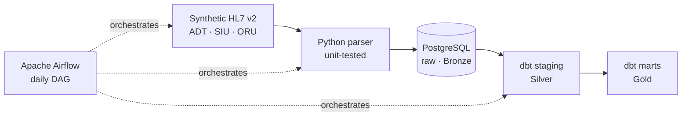
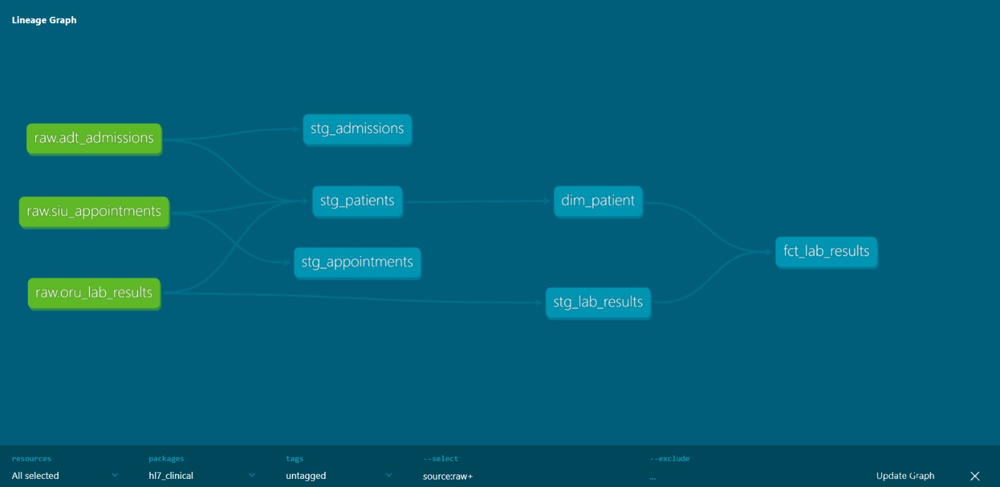

# HL7 Clinical Data Pipeline


End-to-end healthcare data engineering project: synthetic **HL7 v2** hospital messages are ingested into **PostgreSQL**, transformed with **dbt** into an analytics-ready star schema, tested for data quality and orchestrated daily with **Apache Airflow**, all running locally in **Docker**.

> All data is synthetic (generated with Faker). No real patient data is used.

## Why this project

Hospitals exchange admissions, appointments and lab results as HL7 v2 messages. Before clinicians and analysts can use them, someone has to parse them, handle duplicates and missing values, and model them for analysis. This project simulates that daily workflow, including the data quality problems found in real hospital feeds.

## Architecture



| Layer | Schema | Contents |
|---|---|---|
| Bronze | `raw` | Messages exactly as received, all columns as text, with audit columns |
| Silver | `analytics_staging` | Typed, renamed and de-duplicated data |
| Gold | `analytics_marts` | `dim_patient` and `fct_lab_results`, ready for analysis |

## Tech stack

| Area | Tools |
|---|---|
| Ingestion | Python 3.12, custom HL7 v2 parser, psycopg2 |
| Storage | PostgreSQL 16 |
| Transformation | dbt Core (staging → marts, star schema) |
| Orchestration | Apache Airflow 3 (daily DAG) |
| Data quality | 23 dbt tests (unique, not_null, accepted_values, relationships) |
| Testing & CI | pytest, GitHub Actions |
| Infrastructure | Docker, Docker Compose |
| Healthcare standards | HL7 v2 (ADT^A01, SIU^S12, ORU^R01), LOINC |

## Data lineage



## Data quality

The generator deliberately injects real-world issues, and the pipeline handles each one:

| Issue | How it is handled |
|---|---|
| Messages re-sent by the hospital (duplicates) | De-duplicated in staging with `row_number()`, enforced by `unique` tests |
| Missing lab result values | Kept as `NULL`, classified as `Missing`, flagged by a `warn`-severity test |
| Missing birth dates | Recovered by reconciling the same patient across all message types |
| Results for unknown patients | Prevented by a `relationships` test (referential integrity) |
| Non-numeric results | Converted safely with a regex check instead of failing the load |

## Healthcare and privacy considerations

- Synthetic data only; credentials live in an untracked `.env` file.
- Patient names are excluded from the Gold layer (GDPR data minimisation).
- Lab results are coded with real **LOINC** codes and classified against reference ranges.

## How to run

**Prerequisites:** Docker Desktop.

```bash
git clone https://github.com/RenatoMurayama/hl7-clinical-pipeline.git
cd hl7-clinical-pipeline
cp .env.example .env          # Windows: copy .env.example .env

docker compose up -d postgres
docker exec hl7_postgres psql -U clinical -d clinical_dw -c "CREATE DATABASE airflow;"
docker compose up -d --build
```

Open **http://localhost:8080**, activate `hl7_clinical_pipeline` and trigger a run.

**Local development without Airflow** (Python 3.12):

```bash
pip install -r requirements.txt
pytest -v
python src/generate_hl7.py
python src/ingest_hl7.py
cd dbt && dbt build
```

## Project structure

```
├── .github/workflows/ci.yml   # CI: unit tests + full pipeline on every push
├── airflow/                   # Custom Airflow image and daily DAG
├── dbt/models/
│   ├── staging/               # Silver: cleaning, typing, de-duplication
│   └── marts/                 # Gold: dim_patient, fct_lab_results
├── sql/                       # Raw layer DDL
├── src/
│   ├── generate_hl7.py        # Synthetic HL7 v2 generator
│   └── ingest_hl7.py          # Parser and loader (Extract & Load)
├── tests/                     # pytest unit tests
└── docker-compose.yml         # PostgreSQL + Airflow
```

## Design decisions

- **ELT over ETL:** raw data is stored untouched, so any transformation can be fixed and re-run without asking the source for the data again.
- **Idempotent loads:** every run produces the same result, no matter how many times it runs.
- **One transaction per load:** either all data is loaded or none is.
- **dbt in its own virtual environment** inside the Airflow image, to avoid dependency conflicts.

## Possible next steps

- Expose the Gold layer as **HL7 FHIR R4** resources
- Incremental loads instead of full refresh
- Age- and sex-dependent synthetic lab values
- A BI dashboard (Metabase or Superset) on top of the marts
- Migration to a cloud warehouse (BigQuery, Snowflake or Databricks)

## Author

**Renato Murayama**, physiotherapist with 16 years of clinical experience, moving into health data and medical informatics. MSc student in Biomedical Engineering (Medical Informatics), University of Minho.

[LinkedIn](https://www.linkedin.com/in/renatomurayama)
